# Граф 617-9

**Версия:** 18.11.2026.
**Инструмент:** Graphify 0.9.112, скилл `.kimi/skills/graphify`.
**Вход:** `graph_input/` — аналитическая записка, ключевые статьи НК, реестр
федеральных законов, реестр подзаконных актов, структура законопроекта.
**Выход:** `graph.json`, `GRAPH_REPORT.md`, `graph.html`, `617-9_graph.json`.

## Сводка

- 100 узлов, 147 связей, 9 сообществ.
- 91% связей — EXTRACTED (явно в тексте), 9% — INFERRED.
- Средняя уверенность INFERRED-связей — 0.83.
- Граф построен по аналитическому корпусу (~5 000 слов), а не по полному
  600-КБ тексту законопроекта: полный текст остаётся источником страниц,
  граф — навигация по нормам и рискам.

## Главные узлы (god nodes)

| Узел | Связей |
|---|---:|
| Законопроект № 617-9 (текст ко второму чтению, 16.11.2026) | 49 |
| Пояснительная записка к 617-9 (30.09.2026) | 11 |
| Глава 16 НК РФ — штрафы за налоговые правонарушения | 9 |
| Реестр актов корпуса 617-9 | 8 |
| Структура текста ко второму чтению по страницам PDF | 7 |
| Аналитическая записка «617-9: риски для предпринимателя» | 6 |
| Ст. 174.4 НК — НДС при ввозе товаров э-торговли | 6 |
| Ст. 86.6 НК — обязанности оператора цифровой платформы | 6 |
| Ст. 210 п. 2.1 НК — 20 налоговых баз под шкалу 13–22% | 5 |
| Ст. 126.4 НК — штраф платформе 10 000 ₽ за месяц | 5 |

## Сообщества

Сообщества выделены алгоритмом Graphify (Leiden/Louvain); названия «Community N»
условные. Состав сообществ смешанный, поэтому в таблице — только размеры.

| Сообщество | Узлов |
|---|---:|
| 0 | 23 |
| 1 | 21 |
| 2 | 12 |
| 3 | 12 |
| 4 | 11 |
| 5 | 6 |
| 6 | 5 |
| 7 | 5 |
| 8 | 5 |

## Схема верхнего уровня

```mermaid
graph TD
  A["617-9 (ред. 16.11.2026)"] --> B["Штрафы"]
  A --> C["НДФЛ"]
  A --> D["НДС / э-коммерция"]
  A --> E["Платформы"]
  A --> F["Прибыль / фонды"]
  A --> G["Спецрежимы / взносы"]
  A --> H["Администрирование"]
  A --> I["Снятые нормы"]
  B --> B1["ст. 116–135.2: рост в 2,6–3 раза"]
  B --> B2["ст. 128: неявка свидетеля ×14"]
  C --> C1["ст. 210: 20 баз, 13–22%"]
  C --> C2["ст. 224: нерезиденты 30%"]
  C --> C3["ст. 226: банки-агенты"]
  D --> D1["ст. 174.4/174.5: НДС на импорт"]
  D --> D2["ст. 54.2: минимальная цена"]
  E --> E1["ст. 86.6: обмен данными"]
  F --> F1["ст. 284: счёт «С» 35%"]
  F --> F2["ст. 284.12: личные фонды 22%"]
  G --> G1["ст. 346.12: фонды без УСН"]
  G --> G2["ст. 346.15: вклады вне УСН"]
  H --> H1["ст. 61: декабрьский срок"]
  H --> H2["ст. 126 п. 3.1: 121 000 ₽"]
  I --> I1["ПВЗ: снят"]
  I --> I2["Блокировка карточек: снята"]
  I --> I3["КИК 25→50%: нет в тексте"]
```



## Как пользоваться

```bash
graphify query "штрафы 2027" --graph graphify-out/graph.json
graphify query "НДФЛ дивиденды" --graph graphify-out/graph.json
graphify query "цифровые платформы" --graph graphify-out/graph.json
graphify explain "Шкала НДФЛ 13–22%" --graph graphify-out/graph.json
graphify path "НДФЛ" "дивиденды" --graph graphify-out/graph.json
```

`graphify query` возвращает узлы с `source_file` и `source_location` —
по ним видно, откуда взята норма и на какой странице она в PDF.

## Файлы

- `graphify-out/graph.html` — интерактивный граф (открыть в браузере).
- `graphify-out/graph.json` — полный граф.
- `617-9_graph.json` — копия графа для внешних инструментов.
- `graphify-out/GRAPH_REPORT.md` — отчёт Graphify.
- `graphify-out/.graphify_analysis.json` — сообщества, god nodes, вопросы.

## Ограничения

- Граф не заменяет текст закона: он показывает связи, а не точные формулировки.
- `source_location` в графе — это страницы PDF или разделы записки; для
  юридически значимых цитат используйте `sources/pages/page-XXX.txt`.
- Граф построен по редакции 16.11.2026; после второго чтения 19.11.2026
  его нужно пересобрать (`refresh.sh`).
