# Граф 617-9

**Версия:** 18.11.2026.
**Инструмент:** Graphify 0.9.112, скилл `.kimi/skills/graphify`.
**Вход:** `graph_input/` — аналитическая записка, ключевые статьи НК, реестр
федеральных законов, реестр подзаконных актов, структура законопроекта.
**Выход:** `graph.json`, `GRAPH_REPORT.md`, `graph.html`, `617-9_graph.json`.

## Сводка

- 162 узла, 315 связей, 9 сообществ (пересборка после правки записки 18.11.2026).
- 79% связей — EXTRACTED, 20% — INFERRED, 1% — AMBIGUOUS.
- Средняя уверенность INFERRED-связей — 0.86.
- Граф построен по аналитическому корпусу (~5 000 слов), а не по полному
  600-КБ тексту законопроекта: полный текст остаётся источником страниц,
  граф — навигация по нормам и рискам.

## Главные узлы (god nodes)

| Узел | Связей |
|---|---:|
| Законопроект № 617-9 (текст ко второму чтению, 16.11.2026) | 49 |
| Аналитическая записка «617-9: риски для предпринимателя» (версия 18.11.2026) | 34 |
| Риск 14: торговый сбор для кафе и бытовых услуг (гл. 33 НК, ст. 411–417.1) | 23 |
| Риск 1: штрафы за «бумажные» нарушения (гл. 16 НК) | 20 |
| Навигатор «Кому что читать» (группы читателей → разделы записки) | 16 |
| Риск 7: обмен данными маркетплейсов с ФНС (ст. 86.6, 126.4) | 14 |
| Риск 2: НДФЛ 13–22% на доход от вложений (ст. 210, 224) | 12 |
| Риск 8: НДС 22% на интернет-покупки из-за рубежа (ст. 174.4, 174.5) | 11 |
| 07. Реестр актов корпуса 617-9 | 10 |
| Риск 9: минимальная цена для маркированных товаров из ЕАЭС (ст. 54.2) | 10 |

## Сообщества

Сообщества выделены алгоритмом Graphify (Leiden/Louvain), названия даны вручную по составу узлов.

| Сообщество | Название | Узлов |
|---|---|---:|
| 0 | Вклады, взносы и федеральные законы | 26 |
| 1 | Торговый сбор | 26 |
| 2 | Корпус и реестры актов | 23 |
| 3 | Штрафы (гл. 16 НК) | 19 |
| 4 | НДС, импорт и УСН | 18 |
| 5 | Прибыль, фонды и счёт «С» | 17 |
| 6 | Маркетплейсы и подзаконные акты | 16 |
| 7 | НДФЛ и личный план | 13 |
| 8 | Налоговая тайна | 4 |

## Схема верхнего уровня

```mermaid
graph TD
  A["617-9 (ред. 16.11.2026)"] --> B["Штрафы"]
  A --> C["НДФЛ"]
  A --> D["НДС / э-коммерция"]
  A --> E["Платформы"]
  A --> F["Прибыль / фонды"]
  A --> G["Спецрежимы / взносы"]
  A --> H["Администрирование"]
  A --> I["Снятые нормы"]
  A --> J["Торговый сбор"]
  B --> B1["ст. 116–135.2: рост в 2,6–3 раза"]
  B --> B2["ст. 128: неявка свидетеля ×14"]
  C --> C1["ст. 210: 20 баз, 13–22%"]
  C --> C2["ст. 224: нерезиденты 30%"]
  C --> C3["ст. 226: банки-агенты"]
  D --> D1["ст. 174.4/174.5: НДС на импорт"]
  D --> D2["ст. 54.2: минимальная цена"]
  E --> E1["ст. 86.6: обмен данными"]
  F --> F1["ст. 284: счёт «С» 35%"]
  F --> F2["ст. 284.12: личные фонды 22%"]
  G --> G1["ст. 346.12: фонды без УСН"]
  G --> G2["ст. 346.15: вклады вне УСН"]
  H --> H1["ст. 61: декабрьский срок"]
  H --> H2["ст. 126 п. 3.1: 121 000 ₽"]
  I --> I1["ПВЗ: снят"]
  I --> I2["Блокировка карточек: снята"]
  I --> I3["КИК 25→50%: нет в тексте"]
  A --> K["Подзаконные акты"]
  E --> E2["ст. 126.4: 10 000 ₽/мес."]
  F --> F3["ст. 276.1: ЗПИФ 15%"]
  G --> G3["ст. 346.21: УСН минус торговый сбор"]
  J --> J1["ст. 411–417.1: общепит и бытовые услуги"]
  K --> K1["приказы ФНС и постановления Правительства"]
```



## Как пользоваться

```bash
graphify query "штрафы 2027" --graph graphify-out/graph.json
graphify query "НДФЛ дивиденды" --graph graphify-out/graph.json
graphify query "цифровые платформы" --graph graphify-out/graph.json
graphify explain "Шкала НДФЛ 13–22%" --graph graphify-out/graph.json
graphify path "НДФЛ" "дивиденды" --graph graphify-out/graph.json
```

`graphify query` возвращает узлы с `source_file` и `source_location` —
по ним видно, откуда взята норма и на какой странице она в PDF.

## Файлы

- `graphify-out/graph.html` — интерактивный граф (открыть в браузере).
- `graphify-out/graph.json` — полный граф.
- `617-9_graph.json` — копия графа для внешних инструментов.
- `graphify-out/GRAPH_REPORT.md` — отчёт Graphify.
- `graphify-out/.graphify_analysis.json` — сообщества, god nodes, вопросы.

## Ограничения

- Граф не заменяет текст закона: он показывает связи, а не точные формулировки.
- `source_location` в графе — это страницы PDF или разделы записки; для
  юридически значимых цитат используйте `sources/pages/page-XXX.txt`.
- Граф построен по редакции 16.11.2026; после второго чтения 19.11.2026
  его нужно пересобрать (`refresh.sh`).
