# 617-9: риски для предпринимателя

**Версия документа:** 18.11.2026.
**Источник:** законопроект № 617-9, текст ко второму чтению от 16.11.2026
(карточка: https://sozd.duma.gov.ru/bill/617-9).
**Страницы:** ссылки `[стр. N]` — по PDF `sources/617-9_text_2nd_reading_2026-11-16.pdf`
(279 страниц). В Word-версии нумерация может отличаться — цитату всегда можно
найти поиском.

**Статус:** внесён 30.09.2026, первое чтение 29.10.2026, поправки до 12.11.2026,
второе чтение — 19.11.2026. Это ещё не закон: до подписания текст может меняться.
Большая часть норм — с 01.01.2027; отдельные — с 01.03.2027, 01.04.2027,
01.07.2027, 27.07.2027, 01.09.2027, 01.01.2028, 01.07.2028 и 01.01.2030
[стр. 268–275].

**Как читать:** это аналитическая записка, не юридическая консультация.
Цифры проверены по тексту законопроекта; где норма снята или отсутствует,
это указано отдельно. Где написано «оценка» — это мнение автора, а не текст
закона. Незнакомые сокращения объяснены в разделе **«Словарь»** в конце.

---

## Коротко: что реально меняется

1. **Штрафы** за «бумажные» нарушения (опоздали с отчётом, не пришли
   по вызову, не сообщили сведения) вырастут в основном в 2,6–3 раза,
   за неявку свидетеля — в 14 раз → раздел 1.
2. **НДФЛ** с дивидендов, вкладов, ценных бумаг, продажи имущества и ИИС
   будет считаться по общей шкале 13–22% вместо 13/15% → раздел 2.
3. **Банки** будут сами удерживать налог с процентов по вкладам → раздел 2.
4. **Личные фонды** платят 22% и теряют право на УСН; **закрытые паевые
   фонды (ЗПИФ)** для квалифицированных инвесторов начинают платить налог
   на уровне фонда → раздел 3.
5. **Дивиденды на счёт типа «С»** — 35% → раздел 4.
6. **Маркетплейсы** каждый квартал передают в ФНС данные о продавцах;
   за непередачу подтверждения — штраф площадке 10 000 ₽ в месяц → раздел 5.
7. **НДС на покупки за рубежом через интернет**: иностранные продавцы
   и российские маркетплейсы будут платить НДС за покупателя → раздел 6.
8. **Минимальная цена** для маркированных товаров из ЕАЭС → раздел 7.
9. **Филиалы, склады, точки** (обособленные подразделения): новый штраф
   121 000 ₽ за то, что не сообщили о них в налоговую → раздел 8.
10. **Декабрьские сроки** уплаты сдвигаются на предыдущий рабочий день → раздел 8.
11. **Торговый сбор** могут ввести для кафе, ресторанов и бытовых услуг;
    решают муниципалитеты, рамка — с 01.04.2027 → раздел 13.
12. **Часть правил ещё не написана**: Правительство и ФНС должны утвердить
    методики и формы → раздел 14.

**Что убрали из проекта:** налог на пункты выдачи заказов (ПВЗ) по кадастровой
стоимости и блокировку карточек на маркетплейсах. Они были в первой редакции,
но ко второму чтению **исключены** [первая редакция, стр. 153 и 11] → раздел 10.

---

## Кому что читать

| Кто вы | Главное для вас |
|---|---|
| Любая компания или ИП | штрафы (раздел 1), филиалы и декабрьские сроки (раздел 8), правила, которые ещё допишут (раздел 14) |
| ИП и компании на УСН | спецрежимы (раздел 9), торговый сбор (раздел 13) |
| Кафе, рестораны, парикмахерские, ремонт, другие бытовые услуги | торговый сбор (раздел 13) |
| Продавцы на маркетплейсах и сами площадки | раздел 5, НДС на интернет-импорт (раздел 6) |
| Импортёры из стран ЕАЭС и продавцы из-за рубежа | разделы 6 и 7 |
| Частные инвесторы, владельцы вкладов и недвижимости | НДФЛ (раздел 2) |
| Владельцы бизнеса через фонды, ЗПИФ, зарубежные компании | разделы 3, 4 и штрафы по КИК (раздел 1) |
| Гостиницы | туристический налог (раздел 12) |

---

## Реестр рисков

Номер риска не совпадает с номером раздела — раздел указан в отдельной колонке.

| № | Риск | Раздел | Норма | Стр. | Что это значит | Что делать |
|---|---|---:|---|---:|---|---|
| 1 | Штрафы за «бумажные» нарушения | 1 | гл. 16 НК | 39–45 | рост в основном в 2,6–3 раза; неявка свидетеля — в 14 раз | календарь отчётности, ответственный за запросы ФНС, резерв денег |
| 2 | НДФЛ 13–22% на доход от вложений | 2 | ст. 210, 224 | 120–125, 145 | дивиденды, купоны, продажа бумаг и имущества, ЦФА, ИИС | пересчитать личный план на 2026/2027 |
| 3 | Банки удерживают НДФЛ с вкладов | 2 | ст. 226 | 147 | налог удерживают сразу при выплате процентов | учесть, что на руки придёт меньше и раньше уйдёт налог |
| 4 | Личные фонды: 22% и запрет УСН | 3 | ст. 284.12, 346.12 | 182, 226 | рост налога, потеря упрощёнки | проверить структуру фонда |
| 5 | ЗПИФ для квалинвесторов: налог 15% на уровне фонда | 3 | ст. 247, 276.1, 284 | 157–158, 169–174, 181 | налог с пассивного дохода фонда платится сразу, а не при выплате пайщикам | проверить, выгодно ли регулярно выплачивать доход пайщикам |
| 6 | Дивиденды на счёт типа «С» — 35% | 4 | ст. 284 | 181 | рост налога | проверить, как идут выплаты |
| 7 | Обмен данными маркетплейсов с ФНС | 5 | ст. 86.6, 126.4 | 32–34, 41–42 | отметки о риске, запросы документов; штраф площадке 10 000 ₽/мес. | сверить данные, отвечать на сообщения |
| 8 | НДС на интернет-покупки из-за рубежа | 6 | ст. 174.4, 174.5 | 68–77 | +22% к цене импорта; площадки платят НДС за покупателя | пересчитать цену, выяснить роль площадки |
| 9 | Минимальная цена для маркированных товаров ЕАЭС | 7 | ст. 54.2 | 9 | НДС могут досчитать от минимальной цены | готовить документы по ценам |
| 10 | Штраф за несообщение о филиале, складе, точке | 8 | ст. 126 п. 3.1 | 41 | 121 000 ₽ | проверить все точки, склады, офисы |
| 11 | Декабрьский срок уплаты | 8 | ст. 61 | 3 | заплатить нужно раньше — может не хватить денег в конце года | откладывать деньги заранее |
| 12 | Проценты по вкладам убраны из доходов УСН | 9 | ст. 346.15 | 226 | плюс: налог не берут дважды | учесть в расчётах |
| 13 | Взносы «на травматизм» администрирует ФНС | 9 | ст. 1–2 | 4, 250–256 | новая отчётность, ставки те же | проверить расчёты и сроки |
| 14 | Торговый сбор для кафе и бытовых услуг | 13 | гл. 33 НК, ст. 411–417.1 | 239–247 | квартальный местный платёж; больнее всего для помещений >50 кв. м и для арендодателей мест | проверить местные решения, льготы, расчёт |
| 15 | Правила допишут после принятия закона | 14 | ст. 54.2, 86.6, 102, 174.4, 381 | — | точные условия станут известны позже | следить за приказами ФНС и постановлениями |

---

## 1. Штрафы: главный массовый риск

Вырастают штрафы за процедурные нарушения — то есть не за неуплату налога,
а за опоздания, непредставленные документы, неявку по вызову. Ключевые суммы:

| Нарушение | Статья НК | Было | Стало | Стр. |
|---|---|---:|---:|---:|
| Опоздали встать на налоговый учёт | 116 п. 1 | 10 000 ₽ | **30 000 ₽** | 39 |
| Работали, не встав на учёт | 116 п. 2 | 40 000 ₽ | **121 000 ₽** | 39 |
| Опоздали с декларацией (минимальный штраф) | 119 | 1 000 ₽ | **2 600 ₽** | 39 |
| Недостоверные сведения в декларации | 119.2 | 40 000 / 80 000 ₽ | **105 000 / 210 000 ₽** | 40 |
| Грубое нарушение учёта (три уровня тяжести) | 120 | 10 000 / 30 000 / 40 000 ₽ | **28 000 / 83 000 / 111 000 ₽** | 40 |
| Не представили документ (за каждый) | 126 п. 1 | 200 ₽ | **560 ₽** | 40 |
| Отдельные нарушения с документами (крупные составы) | 126 п. 1.1 / 1.2 | 500 000 / 1 000 000 ₽ | **754 000 / 1 510 000 ₽** | 40–41 |
| Не сохранили документы | 125 | 30 000 ₽ | **83 000 ₽** | 40–41 |
| Не сообщили о филиале, складе, точке (новый штраф) | 126 п. 3.1 | — | **121 000 ₽** | 41 |
| Свидетель не пришёл по вызову | 128 ч. 1 | 1 000 ₽ | **14 000 ₽** | 42 |
| Свидетель отказался давать показания или солгал | 128 ч. 2 | 3 000 ₽ | **42 000 ₽** | 42 |
| Эксперт, переводчик или специалист отказался участвовать в проверке / дал ложное заключение | 129 | 500 / 5 000 ₽ | **7 000 / 14 000 ₽** | 42 |
| Не сообщили (или опоздали сообщить) сведения, которые обязаны передавать в налоговую | 129.1 | 5 000 / 20 000 / 50 000 ₽ | **14 000 / 56 000 / 75 000 ₽** | 42 |
| Нарушение порядка постановки на учёт | 129.3 | 500 000 / 30 000 ₽ | **580 000 / 35 000 ₽** | 43 |

Где через косую черту несколько сумм — это разные пункты статьи: первый раз
и повторно, или разные виды нарушения.

Также вырастают:
- **штрафы по зарубежным компаниям под контролем россиян (КИК)** —
  ст. 129.6–129.11, до 1 200 000 ₽ [стр. 43–44];
- **штрафы для банков** — ст. 132, 134, 135.1, 135.2, до 132 000 ₽ [стр. 44–45].

Названия нарушений по ст. 129 и 129.1 даны по действующей редакции НК:
законопроект меняет в этих статьях только суммы.

**Что не меняется:** штрафы за неуплату налога (ст. 122 — 20% или 40%
от суммы) и за неудержание налога с работников (ст. 123 — 20%)
не индексируются. Главный риск — не «доначислили налог»,
а «опоздали с бумагой / не пришли по вызову / не сообщили сведения».

**На практике:** штраф за неявку свидетеля вырос в 14 раз — это уже
не формальность. Если бухгалтер или директор игнорирует вызов инспекции,
это стоит 14 000 ₽, а отказ от показаний — 42 000 ₽.

---

## 2. НДФЛ: доход от вложений облагается сильнее

Сейчас дивиденды, проценты по вкладам, продажа имущества и ряд других доходов
облагаются по ставке 13% (и 15% с суммы свыше 2,4 млн ₽ в год). По тексту
ко второму чтению для них действует общая шкала:

- 13% — до 2,4 млн ₽;
- 15% — 2,4–5 млн ₽;
- 18% — 5–20 млн ₽;
- 20% — 20–50 млн ₽;
- 22% — свыше 50 млн ₽.

Каждый вид дохода считается **отдельно**: дивиденды, вклады, ценные бумаги,
ЦФА, продажа имущества, ИИС, КИК, майнинг и др. — это разные «корзины»
(налоговые базы) [стр. 120–125]. То есть доходы разных видов не складываются
для выбора ставки. Но внутри каждой корзины ставка теперь не 13/15%, а 13–22%.

Для нерезидентов (тех, кто живёт в России меньше 183 дней в году) убраны
льготные 15% по дивидендам и вкладам — применяется общая ставка **30%** [стр. 145].

**Вклады.** Банки и доверительные управляющие сами будут считать и удерживать
НДФЛ при выплате процентов в течение года, а ФНС потом пересчитает итог
по всем банкам [стр. 134–135, 147]. Вычеты (стандартные, социальные,
имущественные) можно применить к процентам по вкладам, если зарплаты
и других основных доходов для вычета не хватило [стр. 128, 141–142].
Для вкладчика это значит: налог будут удерживать сразу, а не по уведомлению
в следующем году.

**Облигации, акции, ИИС, фьючерсы.** Доходы по ценным бумагам и производным
инструментам, включая ИИС, — тоже отдельные корзины по ст. 210 [стр. 120–125].
При крупном доходе ставка может вырасти с 13/15% до 15–22%.

---

## 3. Личные фонды и закрытые паевые фонды

### Личные фонды: 22% и запрет УСН

Личный фонд — это организация, в которую владелец передаёт имущество
(например, доли в бизнесе), чтобы им управляли по его правилам, в том числе
после его смерти. Ставка налога на прибыль для личных фондов повышается
с 15% до **22%** [стр. 182]. Одновременно личные фонды больше не смогут
применять УСН [стр. 226].

Также уточнён перечень доходов, которые засчитываются в 90-процентную
долю «правильных» доходов фонда (добавлены доходы от продажи долговых бумаг
и долговых ЦФА) [стр. 182]. Это техническая деталь, но от неё зависит,
какую ставку применяет фонд.

### ЗПИФ для квалифицированных инвесторов: налог на уровне фонда

Через закрытые паевые инвестиционные фонды (ЗПИФ) владельцы бизнеса часто
держат недвижимость и другие активы. Сейчас доход внутри фонда налогом
не облагается, пока его не выплатят пайщикам.

По законопроекту управляющая компания такого фонда (только для фондов
для квалифицированных инвесторов) должна сама считать налог на прибыль
**15%** с пассивных доходов фонда — дивидендов, процентов, аренды и т. п. —
в день, когда доход поступил в фонд [стр. 157–158, 169–171, 181].
Пайщики-организации могут зачесть этот налог в свой налог на прибыль
[стр. 170–173].

Исключение: управляющая компания вправе не платить этот налог, если фонд
выплачивает доход пайщикам не реже раза в год и в установленном размере
(п. 8 ст. 276.1) [стр. 173–174]. Условия этого пункта стоит разобрать
отдельно с юристом.

**Что это значит:** теряется отсрочка налога, ради которой многие выбирали
ЗПИФ. Нужно проверить, выгодно ли перейти на регулярные выплаты пайщикам.

---

## 4. Дивиденды на счёт типа «С»: 35%

Счёт типа «С» — специальный счёт, на который зачисляются выплаты некоторым
иностранным получателям (указ Президента № 95 от 05.03.2022); снять оттуда
деньги свободно нельзя. Для дивидендов, перечисляемых на такой счёт,
устанавливается ставка **35%** [стр. 181] — это заметно больше обычных 13/15%.

---

## 5. Маркетплейсы: обмен данными есть, блокировок нет

Ст. 86.6 НК была уже в первой редакции [первая редакция, стр. 16]; ко второму
чтению её переписали [стр. 32–34]. Маркетплейс (в законе — «оператор
посреднической цифровой платформы») обязан:

- каждый квартал проверять продавцов по списку «индикаторов риска»
  (признаков возможного ухода от налогов);
- передавать в ФНС результат проверки;
- размещать в личном кабинете продавца сообщение ФНС о выявленных рисках
  и подтверждать налоговой дату размещения.

Если площадка не отправит такое подтверждение вовремя, её оштрафуют
на **10 000 ₽ за каждый месяц** задержки (новая ст. 126.4) [стр. 41–42].
Поэтому площадки будут строго следить, чтобы продавцы видели и обрабатывали
такие сообщения.

Список индикаторов, формы и форматы утверждает ФНС [стр. 32–33]. Пока
приказа нет, неизвестно, что именно станет поводом для сообщения о риске
(см. раздел 14).

**Чего нет:** в первой редакции была ст. 77.1 — приостановка приёма заказов
и показа карточки товара на площадке, в том числе за неявку свидетеля
[первая редакция, стр. 11]. В тексте ко второму чтению этой статьи **нет**.
Блокировки продавцов сейчас в проекте не предусмотрены. Риск смещается
в сторону прозрачности данных и отметок о риске, а не остановки продаж.

---

## 6. НДС на интернет-покупки из-за рубежа: 22%

Новые ст. 174.4 и 174.5 НК [стр. 68–77] вводят НДС на товары, которые люди
покупают у иностранных продавцов через интернет и ввозят в Россию.
Платить НДС за покупателя (быть «налоговым агентом») будут:

- иностранные продавцы;
- иностранные торговые площадки;
- российские маркетплейсы, через которые продаются товары иностранных лиц.

Ставка — обычная (сейчас 22%) [стр. 72, 77]. Для товаров дешевле
беспошлинного порога — с 2027 года (после вступления в силу протокола ЕАЭС),
для товаров дороже порога — с 01.07.2027 [стр. 268–275].

Для иностранного продавца это рост цены; для маркетплейса — новая обязанность
считать и платить налог, сдавать отчётность и отвечать за ошибки.
НДС, который иностранные продавцы и площадки сами заплатили поставщикам,
к вычету не принимается [стр. 72].

---

## 7. Ввоз из стран ЕАЭС: минимальная цена

Новая ст. 54.2 НК [стр. 9]: при ввозе маркированных товаров (тех, что
обязательно помечаются кодом «Честный знак», — одежда, обувь и др.)
из стран ЕАЭС НДС считается от **минимальной цены**, если цена в договоре
ниже. Действует с 01.07.2027 [стр. 268–275].

Для импортёров это риск доначисления НДС: налоговая сможет считать налог
не от цены сделки, а от минимальной цены по методике Правительства
(методики пока нет — см. раздел 14).

---

## 8. Администрирование: филиалы, декабрь, рассрочка, тайна

- **Обособленные подразделения** (филиалы, склады, магазины, офисы — любые
  постоянные рабочие места вне основного адреса). Новый штраф 121 000 ₽
  за то, что не сообщили налоговой о создании подразделения [стр. 41].
  Регионы смогут сообщать налоговикам о неучтённых подразделениях,
  а инспекции — их проверять. Для сетей и бизнеса с несколькими точками
  это прямой риск.
- **Декабрьские сроки.** Если последний день уплаты выпадает на выходной
  с 28 по 31 декабря, срок переносится не на следующий, а на **предыдущий**
  рабочий день [стр. 3]. Деньги нужно иметь раньше — может не хватить
  денег в конце года.
- **Рассрочка после отсрочки (плюс).** Сейчас можно получить либо отсрочку,
  либо рассрочку. По проекту — отсрочку и (или) рассрочку, то есть отложенный
  платёж можно дополнительно разбить на части [стр. 13–14].
- **Налоговая тайна.** Режим распространён на налоговых агентов; расширен
  доступ к данным органов соцзащиты, СФР, ЦБ и учреждений ФСИН [стр. 35].
  Скорее защитная норма, но круг тех, кто видит налоговые данные, растёт.
- **Пени.** Период, за который не начисляются пени по отдельным основаниям,
  продлён с 2026 до 2027 года [стр. 21].

---

## 9. Спецрежимы и взносы

- **УСН, ЕСХН, АУСН:** проценты по вкладам исключены из доходов, чтобы
  не облагать их дважды [стр. 225–226, 261–262]. Плюс для тех, кто держит
  деньги на счетах.
- **Личные фонды:** не вправе применять УСН [стр. 226]. Минус для семейных
  структур.
- **УСН «доходы минус расходы» и торговый сбор:** налог можно будет уменьшить
  на уплаченный торговый сбор [стр. 231–233]. Но есть два условия:
  - уменьшить можно только ту часть налога, которая больше 1% доходов
    (минимальный налог остаётся всегда);
  - если не подать в налоговую уведомление о постановке на учёт
    как плательщик торгового сбора, уменьшение **не положено** —
    ни на УСН «доходы», ни на УСН «доходы минус расходы».
- **Ставки УСН:** 6% / 15%, региональные 1–6% / 5–15% для отдельных видов
  деятельности [стр. 227]. Базовые ставки не меняются.
- **Взносы «на травматизм»** (страхование от несчастных случаев на работе):
  администрирование передаётся из СФР в ФНС; тарифы и выплаты не меняются
  [стр. 4, 250–256]. Меняется, куда и как отчитываться, а не сумма.
- **ИТ-компании:** льготы распространены на электронные книги и публикации
  [стр. 180, 255]; ужесточены условия, при нарушении которых теряется право
  на пониженные тарифы взносов [стр. 255].

---

## 10. Что сняли или чего нет в тексте

Это важно, чтобы не готовиться к тому, чего в проекте нет.

| Норма | Статус | Подтверждение |
|---|---|---|
| Налог на ПВЗ по кадастровой стоимости | **снят** ко второму чтению | был в первой редакции [стр. 153]; в тексте ко второму чтению нормы нет |
| Блокировка приёма заказов и карточек на маркетплейсах (ст. 77.1) | **снята** | была в первой редакции [стр. 11]; в тексте ко второму чтению ст. 77.1 нет |
| КИК: порог 25% → 50%, отмена необлагаемых 10 млн ₽ | **в тексте нет** | заявлено в пояснительной записке; в тексте — только «единоличный контроль = 100%» и уведомления [стр. 5] |
| Автоматическое уменьшение налога на патенте (ПСН) на взносы с 2028 | **в тексте нет** | заявлено в пояснительной записке; в тексте изменений ст. 346.51 нет |
| Расширение налогового мониторинга | **в тексте нет** | заявлено в пояснительной записке; в тексте нормы нет |

**Вывод:** реальных рисков меньше, чем в новостных заголовках. Но штрафы
и НДФЛ в тексте есть, и они остаются.

---

## 11. «Налог на сверхдоходы» — отдельный законопроект

В 617-9 есть только два упоминания: налог добавлен в общий список налогов
[стр. 5] и указано, что он не уменьшает налог на прибыль [стр. 165]. Сам налог
вводится отдельным законопроектом бюджетного пакета — по сообщениям СМИ,
для добывающих компаний; ставка в 617-9 не указана. Для большинства
предпринимателей вне добычи это не риск.

---

## 12. Отраслевые нормы

- **Акцизы:** индексация ставок, жидкости для электронных сигарет без никотина
  становятся подакцизными, изменения для лекарств и виноделия [стр. 81–102].
- **НДПИ** (налог на добычу полезных ископаемых): условия нулевой ставки,
  инвестиционные соглашения [стр. 202 и далее].
- **Туристический налог:** уточнены база и порядок расчёта [стр. 247–249].
  Муниципалитеты смогут снижать минимальный налог — по сезонам, типу
  и категории гостиницы — вплоть до нуля [стр. 248–249]. Плюс для гостиниц.
- **Госпошлина:** отдельные размеры и сроки, в том числе по лекарственным
  препаратам [стр. 186–199].
- **Налог на прибыль:** 35% на счёт «С», 22% для личных фондов, 15% для ЗПИФ,
  ИТ-книги, инвестиционный вычет, продление антикризисных мер [стр. 169–184].

---

## 13. Торговый сбор: кафе, рестораны и бытовые услуги

### Что это и кто решает

Торговый сбор — это ежеквартальный местный платёж за торговую точку.
Сейчас он касается только торговли, и на практике его взимает только Москва. Законопроект
разрешает распространить его на **общепит** (кафе, рестораны, столовые)
и **бытовые услуги** (парикмахерские, химчистки, ремонт и т. п.)
[ст. 413 п. 1, стр. 239–240].

Это **не новый федеральный налог**. Закон лишь даёт право: сбор начнут
брать в конкретном городе только после того, как местная власть примет
своё решение (в Москве, Санкт-Петербурге и Севастополе — городской закон).
Нормы вступают в силу с 01.04.2027 [стр. 271].

### Какие точки попадают под сбор

Четыре вида [ст. 413 п. 3.1–3.3, стр. 240]:

1) общепит с залом для посетителей;
2) общепит без зала (например, точка навынос);
3) бытовые услуги с залом для посетителей;
4) бытовые услуги без зала.

Какие именно бытовые услуги облагаются, решает муниципалитет — выбирая из
списка видов деятельности для патента (подпункты 1–9, 14, 23, 24, 27, 30, 40,
42, 43, 58, 61, 63, 67, 68, 70–74, 77–79 п. 2 ст. 346.43 НК) [стр. 240–241].

### Кто платит

- Обычно — компания или ИП, которые сами оказывают услугу в этой точке.
- **Важно для арендодателей.** Если вы сдаёте оборудованные рабочие места
  (кресла в парикмахерской, места в мастерской), закон может признать вас
  «организатором объекта оказания услуг», и тогда сбор платите вы,
  а не мастер [ст. 417.1 п. 1, стр. 246–247].

**Не платят** [ст. 411, стр. 239]:
- ИП на патенте (ПСН);
- самозанятые (НПД);
- компании и ИП, работающие на розничных рынках;
- мастера, которые работают на месте у «организатора», — по этим видам
  деятельности.

Освобождение действует по закону, отдельного заявления на льготу текст
не требует. Но статус (патент, самозанятость, работа на рынке) лучше
подтвердить документами на случай вопросов.

### Сколько платить

- Платёж — **раз в квартал**, ставку устанавливает муниципалитет в рублях:
  за точку или за квадратный метр зала.
- Для залов **больше 50 кв. м** ставка считается за 1 кв. м и не может быть
  выше стоимости патента на три месяца, делённой на 50 [стр. 244–245].
- Для залов **до 50 кв. м** — ставка за точку в пределах стоимости патента
  на три месяца [ст. 415 п. 1].
- Ставки ежегодно индексируются на коэффициент-дефлятор (поправка
  на инфляцию) [стр. 245–246]. Даже если местная власть ставку не меняет,
  платёж каждый год растёт.

Сбор платится **сверх** обычных налогов. На УСН им можно уменьшить налог —
но только при подаче уведомления о постановке на учёт и в пределах,
описанных в разделе 9.

### Оценка риска

Это **оценка автора**, а не текст закона.

| Параметр | Оценка |
|---|---|
| Вероятность, что сбор введут в конкретном городе | средняя или высокая в 2027–2029 гг.: местным бюджетам нужны доходы |
| Последствия для торговли, общепита, бытовых услуг | средние или высокие: квартальный платёж, зависящий от площади и местной ставки |
| Кому тяжелее всего | залы больше 50 кв. м; арендодатели оборудованных мест; общепит и бытовые услуги |
| Кого почти не касается | ИП на патенте и самозанятые; продавцы на рынках; мастера у «организатора» |
| Итог | средний риск; высокий — для крупных залов и арендодателей мест |

### Что делать

1. Узнать, ввёл ли ваш город сбор, какие ставки и какие бытовые услуги
   в списке.
2. Посчитать сбор по каждой точке за квартал: для залов больше 50 кв. м —
   по площади, для меньших — по ставке за точку.
3. Проверить, не освобождены ли вы (патент, самозанятость, рынок, работа
   у «организатора»), и подготовить подтверждающие документы.
4. Если сдаёте рабочие места — проверить, не становитесь ли вы плательщиком,
   и прописать в договорах, кто что платит.
5. Заложить сбор в бюджет 2027 года в двух вариантах: «ввели / не ввели».
   Не забыть подать уведомление о постановке на учёт, чтобы уменьшить налог
   на УСН.
6. Следить за вторым чтением 19.11.2026 и финальным текстом: список видов
   деятельности, ставки и льготы ещё могут измениться.

---

## 14. Правила допишут после принятия закона

Многие нормы законопроекта только задают рамку, а детали должны утвердить
Правительство и ФНС. Пока этих документов нет, точно просчитать последствия
нельзя [`06_subordinate_acts.md`].

| Что ещё должны утвердить | Кто | Норма | Чего пока не знаем |
|---|---|---|---|
| Список «индикаторов риска» продавцов, формы сообщений | ФНС | ст. 86.6 п. 3 | за что именно продавец получит отметку о риске |
| Правила обмена данными с маркетплейсами | ФНС | ст. 86.6 п. 4 | как и в каком формате площадки передают сведения |
| Методика минимальной цены маркированных товаров | Правительство | ст. 54.2 п. 3, 5 | от какой цены будет считаться НДС при ввозе из ЕАЭС |
| Форма декларации по НДС на интернет-импорт и реестр таможенных деклараций | ФНС | ст. 174.4 п. 7, 8 | как отчитываться площадкам и иностранным продавцам |
| Порядок доступа соцзащиты, СФР, ЦБ и ФСИН к налоговой тайне | ФНС | ст. 102 п. 10, 18, 19 | кто и какие данные будет видеть |
| Перечень испытательных центров (полигонов) для льготы по налогу на имущество | Правительство | ст. 381 п. 30 | кто получит льготу |

**Что делать:** назначить человека, который следит за проектами приказов
на regulation.gov.ru и сайте ФНС, и пересчитывать оценки по мере их выхода.

---

## Что делать уже сейчас

1. **Пересобрать бюджет 2027** с новыми штрафами и НДФЛ: резерв на
   процедурные ошибки, календарь отчётности, ответственный за запросы
   и вызовы из налоговой.
2. **Проверить личный план на 2026/2027:** дивиденды, вклады, продажа бумаг
   и недвижимости, ИИС, фьючерсы. Если доход можно законно получить в 2026
   году — посчитать разницу, но без схем дробления и уклонения.
3. **Проверить все точки, склады и офисы:** о каждом ли подразделении
   знает налоговая. Иначе — 121 000 ₽ за каждое.
4. **Маркетплейсам и продавцам:** сверить данные, назначить ответственного
   за сообщения ФНС в личном кабинете, хранить документы. Блокировок
   в текущем тексте нет, но обмен данными и отметки о риске — есть.
5. **Продавцам из-за рубежа:** заложить 22% НДС в цену, выяснить,
   кто платит налог — иностранная площадка или российский маркетплейс,
   подготовить реестры деклараций.
6. **Импортёрам из ЕАЭС:** подготовить документы, подтверждающие цены
   на маркированные товары, — с 01.07.2027 налоговая сможет считать НДС
   от минимальной цены.
7. **Кафе, ресторанам и бытовым услугам:** следить за решениями своего
   города по торговому сбору (раздел 13).
8. **Владельцам ЗПИФ и личных фондов:** пересчитать налог по новым правилам
   (раздел 3).
9. **Следить за вторым чтением 19.11.2026** и финальным текстом: часть норм
   может измениться, часть — вернуться.

---

## Словарь

| Термин | Простыми словами |
|---|---|
| НК | Налоговый кодекс РФ — главный закон о налогах |
| НДФЛ | налог на доходы физических лиц (зарплата, дивиденды, проценты, продажа имущества) |
| НДС | налог на добавленную стоимость, входит в цену товара; основная ставка — 22% |
| УСН | упрощённая система налогообложения («упрощёнка»): 6% с доходов или 15% с разницы «доходы минус расходы» |
| ПСН | патентная система: ИП покупает патент на вид деятельности вместо уплаты обычных налогов |
| НПД | налог на профессиональный доход — режим для самозанятых |
| АУСН | автоматизированная УСН — экспериментальный режим, где налог считает налоговая |
| ЕСХН | единый сельскохозяйственный налог — режим для фермеров |
| Налоговый агент | тот, кто считает и платит налог за другого (например, работодатель за работника, банк за вкладчика) |
| Обособленное подразделение | любое постоянное рабочее место вне основного адреса компании: филиал, склад, магазин, офис |
| КИК | контролируемая иностранная компания — зарубежная компания, которой владеет или управляет россиянин |
| ЦФА | цифровые финансовые активы — цифровые права, выпускаемые на специальных платформах |
| ИИС | индивидуальный инвестиционный счёт у брокера с налоговыми льготами |
| ЗПИФ | закрытый паевой инвестиционный фонд; через него часто держат недвижимость и активы |
| Квалифицированный инвестор | инвестор с крупным капиталом или опытом, которому доступны рискованные инструменты |
| Личный фонд | организация, которой владелец передаёт имущество для управления по своим правилам, в том числе после смерти |
| Счёт типа «С» | специальный счёт для выплат некоторым иностранным получателям; деньги с него нельзя свободно вывести |
| ЕАЭС | Евразийский экономический союз: Россия, Беларусь, Казахстан, Армения, Киргизия |
| Маркированные товары | товары с обязательным кодом «Честный знак» (одежда, обувь, лекарства и др.) |
| ПВЗ | пункт выдачи заказов маркетплейса |
| СФР | Социальный фонд России (бывшие ПФР и ФСС) |
| Коэффициент-дефлятор | ежегодная поправка на инфляцию, которую утверждает Минэкономразвития |
| Пени | плата за каждый день просрочки налога |
| НДПИ | налог на добычу полезных ископаемых |

---

## Приложение: граф норм и рисков

Ниже — верхнеуровневая схема. Полный интерактивный граф —
`graphify-out/graph.html`; машиночитаемый — `graphify-out/graph.json` и
`617-9_graph.json` (162 узла, 315 связей; пересобран по этой версии записки).

```mermaid
graph TD
  A["617-9 (ред. 16.11.2026)"] --> B["Штрафы"]
  A --> C["НДФЛ"]
  A --> D["НДС / э-коммерция"]
  A --> E["Платформы"]
  A --> F["Прибыль / фонды"]
  A --> G["Спецрежимы / взносы"]
  A --> H["Администрирование"]
  A --> I["Снятые нормы"]
  A --> J["Торговый сбор"]
  A --> K["Подзаконные акты"]
  B --> B1["ст. 116–135.2: рост в основном 2,6–3 раза"]
  B --> B2["ст. 128: неявка свидетеля ×14"]
  C --> C1["ст. 210: 20 баз, 13–22%"]
  C --> C2["ст. 224: нерезиденты 30%"]
  C --> C3["ст. 226: банки-агенты"]
  D --> D1["ст. 174.4/174.5: НДС на импорт"]
  D --> D2["ст. 54.2: минимальная цена"]
  E --> E1["ст. 86.6: обмен данными"]
  E --> E2["ст. 126.4: 10 000 ₽/мес."]
  F --> F1["ст. 284: счёт «С» 35%"]
  F --> F2["ст. 284.12: личные фонды 22%"]
  F --> F3["ст. 276.1: ЗПИФ 15%"]
  G --> G1["ст. 346.12: фонды без УСН"]
  G --> G2["ст. 346.15: вклады вне УСН"]
  G --> G3["ст. 346.21: УСН минус торговый сбор"]
  H --> H1["ст. 61: декабрьский срок"]
  H --> H2["ст. 126 п. 3.1: 121 000 ₽"]
  I --> I1["ПВЗ: снят"]
  I --> I2["Блокировка карточек: снята"]
  I --> I3["КИК 25→50%: нет в тексте"]
  J --> J1["ст. 411–417.1: общепит и бытовые услуги"]
  K --> K1["приказы ФНС и постановления Правительства"]
```

---

## Источники

- Карточка законопроекта: https://sozd.duma.gov.ru/bill/617-9
- Текст ко второму чтению (16.11.2026): `sources/617-9_text_2nd_reading_2026-11-16.doc` / `.pdf`
- Пояснительная записка: `sources/617-9_explanatory_note_2026-09-30.docx`
- Первая редакция: `sources/617-9_text_1st_reading_2026-10-26.docx`
- Постраничный текст: `sources/pages/page-XXX.txt`, индекс `sources/page_index.tsv`
- Реестр подзаконных актов: `corpus/06_subordinate_acts.md`
- Корпус: `617-9_corpus.md`
- Ревью Qwen 3.8 Flash: `617-9_review_qwen.md`
- Отдельный законопроект о налоге на сверхдоходы (вне 617-9): https://www.rbc.ru/economics/29/10/2026/6ae36fc4a3029cda5695e18c
