# 617-9: риски для предпринимателя

**Версия документа:** 18.11.2026.
**Источник:** законопроект № 617-9, текст ко второму чтению от 16.11.2026
(карточка: https://sozd.duma.gov.ru/bill/617-9).
**PDF-рендер:** `sources/617-9_text_2nd_reading_2026-11-16.pdf`, 279 страниц,
экспорт Apple Pages. Номера страниц в ссылках `[стр. N]` — по этому PDF;
на каждой странице PDF есть колонцифра. В свойствах `.doc` указано 293 страницы,
поэтому пагинация Word может отличаться — цитату всегда можно найти поиском.

**Статус:** внесён 30.09.2026, первое чтение 29.10.2026, поправки до 12.11.2026,
второе чтение — 19.11.2026. Это ещё не закон: до подписания текст может меняться.
Большая часть норм — с 01.01.2027; отдельные — с 01.03.2027, 01.04.2027,
01.07.2027, 27.07.2027, 01.09.2027, 01.01.2028, 01.07.2028 и 01.01.2030
[стр. 268–275].

**Как читать:** это аналитическая записка, не юридическая консультация.
Все цифры проверены по тексту законопроекта; где норма снята или отсутствует,
это указано отдельно.

---

## Коротко: что реально меняется

1. **Штрафы** по процедурным составам индексируются в основном в 2,6–3 раза;
   по допросным составам — до 14 раз, отдельные крупные суммы — в 1,5 раза
   [стр. 39–49].
2. **НДФЛ** на дивиденды, вклады, ценные бумаги, ЦФА, продажу имущества и ИИС
   переходит в общую шкалу 13–22% [стр. 120–125, 145].
3. **Банки** становятся налоговыми агентами по процентам по вкладам [стр. 147].
4. **Личные фонды** платят 22% и не могут применять УСН [стр. 182, 226].
5. **Дивиденды на счёт типа «С»** — 35% [стр. 181].
6. **Цифровые платформы** ежеквартально передают в ФНС данные о продавцах
   по индикаторам риска [стр. 32–34].
7. **НДС на электронную торговлю**: иностранные продавцы и российские
   маркетплейсы — налоговые агенты [стр. 68–77].
8. **Минимальная цена** для маркированных товаров из ЕАЭС [стр. 9].
9. **Обособленные подразделения**: новый штраф 121 000 ₽ [стр. 41].
10. **Декабрьские сроки** уплаты сдвигаются на предыдущий рабочий день [стр. 3].
11. **Торговый сбор** расширяется на общепит и бытовые услуги; решение —
    за муниципалитетами, рамка — с 01.04.2027 [стр. 239–240, 271].

При этом **налог на ПВЗ по кадастровой стоимости** и **блокировка карточек
на маркетплейсах**, которые были в первой редакции, ко второму чтению
**исключены** [первая редакция, стр. 153 и 11]. Это главные «снятые» риски.

---

## Реестр рисков

| № | Риск | Норма | Стр. | Эффект | Что делать |
|---|---|---|---:|---|---|
| 1 | Штрафы за процедурные нарушения | гл. 16 НК | 39–49 | рост в основном 2,6–3 раза; неявка свидетеля — в 14 раз | календарь отчётности, ответственный за требования ФНС, резерв |
| 2 | НДФЛ 13–22% на инвестиционный доход | ст. 210, 224 | 120–125, 145 | дивиденды, купоны, продажа бумаг/имущества, ЦФА, ИИС | пересчитать личный план на 2026/2027 |
| 3 | Банки удерживают НДФЛ с вкладов | ст. 226 | 147 | налог удерживается при выплате процентов | учесть cash-flow по вкладам |
| 4 | Личные фонды: 22% и запрет УСН | ст. 284.12, 346.12 | 182, 226 | рост налога, потеря спецрежима | проверить структуру фонда |
| 5 | Дивиденды на счёт типа «С» — 35% | ст. 284 | 181 | рост налога | проверить маршрут выплат |
| 6 | Обмен данными платформ с ФНС | ст. 86.6 | 32 | «флаги» риска, запросы документов | сверить данные, отвечать на сообщения |
| 7 | НДС на электронную торговлю | ст. 174.4, 174.5 | 68–77 | +22% к импорту, агентские обязанности | пересчитать цену, проверить роль площадки |
| 8 | Минимальная цена для маркированных товаров ЕАЭС | ст. 54.2 | 9 | доначисления НДС | готовить документы по ценам |
| 9 | Штраф за несообщение об обособленном подразделении | ст. 126 п. 3.1 | 41 | 121 000 ₽ | инвентаризация точек/складов/офисов |
| 10 | Декабрьский срок уплаты | ст. 61 | 3 | кассовый разрыв в конце года | резервировать деньги заранее |
| 11 | Проценты по вкладам исключены из УСН | ст. 346.15 | 226 | плюс: нет двойного налога | учесть в расчётах |
| 12 | Травматизм администрирует ФНС | ст. 1–2 | 4, 250–256 | новая отчётность, ставки не меняются | проверить расчёты и сроки |
| 13 | Торговый сбор распространяется на общепит и бытовые услуги | гл. 33 НК, ст. 413–417.1 | 239–247 | квартальный местный сбор; риск для объектов >50 кв. м и организаторов | проверить местные акты, льготы и расчёт |

---

## 1. Штрафы: главный массовый риск

Индексация касается процедурных составов. Ключевые суммы:

| Нарушение | Было | Стало | Стр. |
|---|---:|---:|---:|
| Нарушение срока постановки на учёт | 10 000 ₽ | **30 000 ₽** | 39 |
| Деятельность без постановки на учёт | 40 000 ₽ | **121 000 ₽** | 39 |
| Несвоевременная декларация (минимум) | 1 000 ₽ | **2 600 ₽** | 39 |
| Непредставление документа (за документ) | 200 ₽ | **560 ₽** | 40 |
| Грубое нарушение учёта | 10 000 / 30 000 / 40 000 ₽ | **28 000 / 83 000 / 111 000 ₽** | 40 |
| Нехранение документов | 30 000 ₽ | **83 000 ₽** | 40 |
| Неявка свидетеля | 1 000 / 3 000 ₽ | **14 000 / 42 000 ₽** | 42 |
| Отказ от показаний | 500 / 5 000 ₽ | **7 000 / 14 000 ₽** | 42 |
| Воспрепятствование доступу | 5 000 / 20 000 / 50 000 ₽ | **14 000 / 56 000 / 75 000 ₽** | 42 |
| Несообщение об обособленном подразделении | — | **121 000 ₽** | 41 |

**Что не меняется:** штрафы за неуплату налога (ст. 122 — 20/40%) и
неудержание (ст. 123 — 20%) в законопроекте не индексируются. Главный риск —
не «доначислили налог», а «опоздали с бумагой / не пришли по вызову».

**Практика:** штраф за неявку свидетеля вырос в 14 раз — это уже не
«формальность». Если бухгалтер или директор игнорирует вызов инспекции,
цена ошибки — 14 000–42 000 ₽, а в сочетании с последующими проверками
и блокировками (если они вернутся в третьем чтении) — больше.

---

## 2. НДФЛ: инвестиционный доход дорожает

Сейчас дивиденды, проценты по вкладам, продажа имущества и ряд других доходов
облагаются по специальной шкале 13/15% с порогом 2,4 млн ₽. По тексту
ко второму чтению эти доходы включаются в общую шкалу:

- 13% — до 2,4 млн ₽;
- 15% — 2,4–5 млн ₽;
- 18% — 5–20 млн ₽;
- 20% — 20–50 млн ₽;
- 22% — свыше 50 млн ₽.

При этом каждая налоговая база считается **отдельно**: дивиденды, вклады,
ценные бумаги, ЦФА, продажа имущества, ИИС, КИК, майнинг и др. — это разные
базы [стр. 120–125]. То есть шкала применяется не к совокупному доходу,
а к каждой базе отдельно; но сама ставка по дивидендам и вкладам теперь
не 13/15%, а 13–22%.

Для нерезидентов убраны специальные ставки 15% по дивидендам и вкладам —
применяется общая **30%** [стр. 145].

**Вклады.** Банки и доверительные управляющие становятся налоговыми агентами:
они исчисляют и удерживают НДФЛ при выплате процентов в течение года,
а ФНС потом пересчитывает по всем банкам [стр. 147]; пересчёт ФНС — [стр. 134–135]. Вычеты (стандартные,
социальные, имущественные) разрешено применять к процентам по вкладам, если
основной базы не хватило [стр. 128, 141–142]. Для инвестора это означает:
налог с процентов будет удерживаться раньше, чем вы привыкли.

**Купоны, бумаги, ИИС, фьючерсы.** Доходы по операциям с ценными бумагами
и производными финансовыми инструментами, включая ИИС, входят в базы
по ст. 210 [стр. 120–125]. Если у вас брокерский счёт с облигациями/фьючерсами,
эффективная ставка может вырасти с 13/15% до 15–22% в зависимости от размера
базы.

---

## 3. Личные фонды: 22% и запрет УСН

Для личных фондов ставка налога на прибыль повышается с 15% до **22%**
[стр. 182]. Одновременно личные фонды добавляются в перечень организаций,
которые не вправе применять УСН [стр. 226]. Если фонд — часть структуры
владения, его экономика меняется: 22% на прибыль плюс потеря спецрежима.

Расширен перечень доходов, которые учитываются в 90-процентной доле доходов
фонда для применения ставки 22% — добавлены доходы от реализации долговых
ценных бумаг и долговых ЦФА [стр. 182]. Это техническое уточнение, но оно
влияет на право применять ставку.

---

## 4. Дивиденды на счёт типа «С»: 35%

Для дивидендов, перечисляемых на счёт типа «С» (указ № 95 от 05.03.2022),
устанавливается ставка **35%** [стр. 181]. Для получателей таких выплат это
существенный рост по сравнению с обычными 13/15%.

---

## 5. Маркетплейсы: обмен данными есть, блокировки нет

Ст. 86.6 НК была уже в первой редакции [первая редакция, стр. 16]; ко второму чтению она изложена в новой редакции [стр. 32–34]. Оператор
посреднической цифровой платформы обязан:

- ежеквартально определять соответствие деятельности продавца перечню
  индикаторов риска;
- передавать в ФНС информацию о соответствии/несоответствии;
- размещать в личном кабинете продавца сообщение ФНС о выявленных рисках
  и подтверждать дату размещения.

Перечень индикаторов, формы и форматы утверждает ФНС [стр. 32–33]. Пока
приказа нет, точные триггеры неизвестны — это отдельный риск.

**Чего нет:** в первой редакции была ст. 77.1 — приостановление приёма
заказов и размещения карточки товара на платформе, в том числе за неявку
свидетеля [первая редакция, стр. 11]. В тексте ко второму чтению этой статьи
**нет**. То есть блокировки продавцов на всех площадках сейчас в проекте
не предусмотрено. Риск смещается в сторону прозрачности данных и «флагов»
риска, а не остановки продаж.

---

## 6. НДС на электронную торговлю: 22% и агенты

Новые ст. 174.4 и 174.5 НК [стр. 68–77] вводят НДС при ввозе товаров
электронной торговли, приобретённых физлицами. Налоговыми агентами
признаются:

- иностранные продавцы;
- иностранные торговые площадки;
- российские маркетплейсы, через которые продаются товары иностранных лиц.

Ставка — стандартная (сейчас 22%) [стр. 72, 77]. Для товаров ниже
беспошлинного порога — с 2027 года (увязано со вступлением в силу протокола
ЕАЭС), для товаров выше порога — с 01.07.2027 [стр. 268–275].

Для селлера это новая стоимость в цене; для маркетплейса — агентская функция,
отчётность и ответственность. Отдельно уточняется, что «входной» НДС
у иностранных продавцов и площадок к вычету не принимается [стр. 72].

---

## 7. Импорт из ЕАЭС: минимальная цена

Новая ст. 54.2 НК [стр. 9] устанавливает: при ввозе маркированных товаров
из стран ЕАЭС для целей НДС применяется **минимальная цена единицы товара**,
если фактическая цена ниже. Применяется с 01.07.2027 [стр. 268–275].

Для импортёров одежды, обуви и других маркированных товаров это риск
доначислений НДС: налоговики смогут считать базу не от цены сделки, а от
минимальной цены по методике Правительства.

---

## 8. Администрирование: подразделения, декабрь, тайна

- **Обособленные подразделения.** Новый штраф 121 000 ₽ за несообщение
  о создании подразделения [стр. 41]. Регионы смогут сообщать налоговикам
  о неучтённых подразделениях, а инспекции — проводить контрольные
  мероприятия. Для сетей, складов и «точек» это прямой риск.
- **Декабрьские сроки.** Если последний день уплаты приходится на выходной
  в период 28–31 декабря, срок переносится на предшествующий рабочий день
  [стр. 3]. Деньги нужно иметь раньше — риск кассового разрыва.
- **Налоговая тайна.** Режим распространён на налоговых агентов; расширен
  доступ органов соцзащиты и СФР [стр. 35]. Скорее защитная норма, но
  обмен данными расширяется.
- **Пени.** Период, за который не начисляются пени по отдельным основаниям,
  продлён с 2026 до 2027 года [стр. 21].

---

## 9. Спецрежимы и взносы

- **УСН/ЕСХН/АУСН:** проценты по вкладам исключены из доходов, чтобы
  не облагать их дважды [стр. 225–226, 261–262]. Плюс для тех, кто держит деньги на счетах.
- **Личные фонды:** не вправе применять УСН [стр. 226]. Минус для семейных
  структур.
- **УСН «доходы минус расходы»:** появляется уменьшение на торговый сбор
  [стр. 231]. Плюс для торговли.
- **Ставки УСН:** 6% / 15%, региональные 1–6% / 5–15% для перечня ОКВЭД
  [стр. 227]. Базовые ставки не меняются.
- **Травматизм:** администрирование передаётся ФНС; тарифы и обеспечение
  не меняются [стр. 4, 250–256]. Административная нагрузка, не рост ставки.
- **ИТ:** преференции распространены на электронные книги и публикации
  [стр. 180, 255]; ужесточены условия по взаимозависимым лицам и отчётности.

---

## 10. Что сняли или чего нет в тексте

Это важно, чтобы не готовиться к тому, чего в проекте нет.

| Норма | Статус | Подтверждение |
|---|---|---|
| Налог на ПВЗ по кадастровой стоимости | **снят** ко второму чтению | был в первой редакции [стр. 153]; в тексте ко второму чтению нормы нет |
| Блокировка приёма заказов/карточек на маркетплейсах (ст. 77.1) | **снята** | была в первой редакции [стр. 11]; в тексте ко второму чтению ст. 77.1 нет |
| КИК: порог 25% → 50%, отмена необлагаемых 10 млн ₽ | **в тексте нет** | в записке заявлено; в тексте — только единоличный контроль = 100% и уведомления [стр. 5] |
| Автоматическое уменьшение ПСН на взносы с 2028 | **в тексте нет** | в записке заявлено; в тексте изменений ст. 346.51 нет |
| Расширение периметра налогового мониторинга | **в тексте нет** | в записке заявлено; в тексте нормы нет |

**Вывод:** реальные риски уже, чем новостные заголовки. Но штрафы и НДФЛ —
в тексте, и они остаются.

---

## 11. «Налог на сверхдоходы» — отдельный законопроект

В 617-9 есть только два следа: налог добавлен в перечень налогов [стр. 5]
и указано, что он не учитывается при исчислении налога на прибыль
[стр. 165]. Сам налог вводится отдельным законопроектом бюджетного пакета —
по сообщениям, для добывающих компаний; в 617-9 ставка не указана. Для большинства предпринимателей
вне добычи это не риск; для добывающих — отдельный анализ.

---

## 12. Отраслевые нормы

- **Акцизы:** индексация ставок, безникотиновые жидкости, лекарства,
  виноделие [стр. 81–102].
- **НДПИ:** условия нулевой ставки, инвестиционные соглашения, коэффициент
  Ктд [стр. 202 и далее].
- **Туристический налог:** уточнение базы и порядка исчисления
  [стр. 247–249].
- **Госпошлина:** отдельные размеры и сроки, в том числе по лекарственным препаратам [стр. 186–199].
- **Налог на прибыль:** 35% на счёт «С», 22% для личных фондов, ИТ-книги,
  инвестиционный вычет, антикризисные меры [стр. 179–184].

---

## 13. Торговый сбор: расширение на общепит и бытовые услуги

### 13.1. Источник и правовая природа

Пункт 1 статьи 413 НК РФ в редакции ко второму чтению изложен в новой
редакции: «Сбор устанавливается в отношении осуществления торговой
деятельности и (или) деятельности в сфере оказания услуг общественного
питания и (или) бытовых услуг населению...» [стр. 239–240; в Word-версии
(293 стр.) — стр. 251, как указано в запросе].

Речь идет не о введении нового федерального налога, а о расширении
предмета регулирования главы 33 НК РФ «Торговый сбор». Торговый сбор
является местным сбором, устанавливаемым нормативными правовыми актами
представительных органов муниципальных образований (законами городов
федерального значения Москвы, Санкт-Петербурга и Севастополя).
Следовательно, федеральный закон расширяет потенциальный круг видов
деятельности, но не вводит сбор автоматически на всей территории
Российской Федерации: юридическое основание для взимания возникает
только после принятия соответствующего местного акта.

### 13.2. Содержание изменения

В соответствии с пунктами 3.1–3.3 статьи 413 НК РФ к деятельности по
оказанию услуг отнесены:

1) услуги общественного питания через объекты с залом обслуживания
посетителей;
2) услуги общественного питания через объекты без зала обслуживания
посетителей;
3) бытовые услуги населению через объекты с залом обслуживания
посетителей;
4) бытовые услуги населению через объекты без зала обслуживания
посетителей [стр. 240].

К деятельности по оказанию услуг приравнена деятельность по организации
объектов оказания услуг [стр. 240]. Виды бытовых услуг, облагаемых
сбором, устанавливаются местными актами из перечня видов деятельности,
предусмотренных для патентной системы налогообложения (подпункты 1–9,
14, 23, 24, 27, 30, 40, 42, 43, 58, 61, 63, 67, 68, 70–74, 77–79 пункта 2
статьи 346.43 НК РФ) [стр. 240–241].

В пункте 4 статьи 413 вводятся определения: «объект оказания услуг»,
«объект оказания услуг, имеющий зал обслуживания посетителей», «объект
оказания услуг, не имеющий зала обслуживания посетителей», «площадь зала
обслуживания посетителей», «деятельность по организации объектов оказания
услуг», «организатор объекта оказания услуг», «исполнитель»,
«инвентаризационные и правоустанавливающие документы» [стр. 241–243].
Указанные определения расширяют круг объектов и лиц, в отношении которых
может быть установлен сбор.

### 13.3. Круг плательщиков и объект обложения

Плательщиками сбора признаются организации и индивидуальные
предприниматели, осуществляющие деятельность по оказанию услуг с
использованием объекта оказания услуг. В отдельных случаях, предусмотренных
пунктом 1 статьи 417.1 НК РФ, плательщиком признается организатор объекта
оказания услуг [стр. 246–247]. Для хозяйствующих субъектов, предоставляющих
оборудованные места для оказания бытовых услуг (парикмахерских,
ремонтных, иных услуг), это создает риск возложения обязанности по уплате
сбора на организатора, а не на исполнителя.

От уплаты сбора освобождаются индивидуальные предприниматели,
применяющие патентную систему налогообложения, и индивидуальные
предприниматели, применяющие специальный налоговый режим «Налог на
профессиональный доход»; организации и индивидуальные предприниматели,
осуществляющие деятельность на розничных рынках, и исполнители бытовых
услуг — по соответствующим видам деятельности [стр. 239]. Льготы носят
заявительный характер и требуют документального подтверждения статуса и
условий.

### 13.4. Ставки и порядок исчисления

Налоговый период — квартал. Ставки устанавливаются местными актами в
рублях за квартал в расчете на объект осуществления торговли (объект
оказания услуг) или на площадь торгового зала (зала обслуживания
посетителей). Для объектов с площадью торгового зала (зала обслуживания
посетителей) более 50 квадратных метров ставка устанавливается в расчете
на 1 квадратный метр и не может превышать расчетную сумму налога по
патентной системе налогообложения на основании патента на три месяца,
деленную на 50 [стр. 244–245]. Для объектов с площадью до 50 квадратных
метров применяется местная ставка в пределах расчетной суммы патента на
три месяца (пункт 1 статьи 415 НК РФ).

Предусмотрена ежегодная индексация ставок на коэффициент-дефлятор, а
также специальный порядок индексации при изменении ставок или введении
новых видов деятельности [стр. 245–246]. Следовательно, даже при
стабильной номинальной ставке платеж будет ежегодно увеличиваться.

Сбор уплачивается в дополнение к налогу, уплачиваемому в связи с
применением соответствующего режима налогообложения. Для организаций и
индивидуальных предпринимателей, применяющих УСН с объектом «доходы минус
расходы», законопроект прямо предусматривает уменьшение налога на сумму
торгового сбора [стр. 231]. Для ПСН и НПД действуют освобождения,
указанные в разделе 13.3.

### 13.5. Оценка риска

| Параметр | Оценка |
|---|---|
| Вероятность введения сбора в конкретном муниципалитете | средняя/высокая в 2027–2029 гг. в связи с потребностью в местных доходах |
| Последствия для торговли, общепита, бытовых услуг | средние/высокие; квартальный платеж, зависящий от площади и местной ставки |
| Наиболее уязвимые | объекты с площадью зала более 50 кв. м; организаторы объектов оказания услуг; общепит и бытовые услуги |
| Наименее уязвимые | ИП на ПСН и НПД; организации и ИП на розничных рынках; исполнители бытовых услуг |
| Итоговый уровень | средний; потенциально высокий для крупных объектов и организаторов |

Существенно, что федеральный закон не устанавливает сбор повсеместно:
решение принимается муниципалитетом. Однако сама конструкция «сбор
устанавливается в отношении...» создает правовую возможность для
распространения сбора на общепит и бытовые услуги, а ежегодная индексация
и расширение круга плательщиков усиливают фискальную нагрузку.

### 13.6. Рекомендуемые действия

1. Проверить нормативные правовые акты муниципальных образований, на
   территории которых расположены объекты: введен ли сбор, какие ставки
   и виды бытовых услуг установлены.
2. Рассчитать сбор по каждому объекту за квартал: для объектов более
   50 кв. м — по площади и предельному размеру, для объектов до 50 кв. м —
   по местной ставке.
3. Проверить право на освобождение (ПСН, НПД, розничные рынки,
   исполнители бытовых услуг) и документы, подтверждающие статус.
4. Проверить, не признается ли хозяйствующий субъект организатором
   объекта оказания услуг и, соответственно, плательщиком сбора; отразить
   распределение обязанностей в договорах.
5. Учесть сбор в бюджете 2027 года по сценариям «введен / не введен» и
   «ставка ниже / выше предельной»; проверить возможность уменьшения
   налога на прибыль/УСН.
6. Осуществлять мониторинг второго чтения 19.11.2026 и финального текста:
   круг видов деятельности, ставки и льготы могут измениться.

### 13.7. Вывод

Рассматриваемая норма не вводит новый федеральный налог, а расширяет
рамку местного торгового сбора на общественное питание и бытовые услуги.
Риск носит вероятностный (региональный) характер: он реализуется только
при принятии местного акта. Наиболее значим риск для объектов с площадью
зала более 50 кв. м, для общепита и бытовых услуг, а также для
организаторов объектов оказания услуг. Для ИП на ПСН и НПД, организаций и
ИП на розничных рынках и исполнителей бытовых услуг предусмотрены
освобождения. С учетом вступления норм в силу с 01.04.2027 [стр. 271]
хозяйствующим субъектам рекомендуется включить указанный риск в
бюджетный и договорный контур 2027 года.

---

## Что делать уже сейчас

1. **Пересобрать бюджет 2027** с новыми штрафами и НДФЛ: резерв на
   процедурные ошибки, календарь отчётности, ответственный за требования ФНС.
2. **Проверить личный план 2026/2027:** дивиденды, вклады, продажа бумаг
   и недвижимости, ИИС, фьючерсы. Если доход можно получить в 2026 году —
   просчитать разницу, но без схем дробления и уклонения.
3. **Маркетплейсам и селлерам:** сверить данные, назначить ответственного
   за сообщения ФНС в кабинете, хранить документы. Блокировки в текущем
   тексте нет, но обмен данными и «флаги» — есть.
4. **Кросс-бордерам:** заложить 22% НДС в цену, определить, кто налоговый
   агент — иностранная площадка или российский маркетплейс, подготовить
   реестры деклараций.
5. **Импортёрам из ЕАЭС:** подготовить документы по ценам на маркированные
   товары — с 01.07.2027 налоговики смогут считать НДС от минимальной цены.
6. **Следить за вторым чтением 19.11.2026** и финальным текстом: часть норм
   может измениться, часть — вернуться.

---

## Граф

Ниже — верхнеуровневый граф норм и рисков. Полный интерактивный граф —
`graphify-out/graph.html`; машиночитаемый — `graphify-out/graph.json` и
`617-9_graph.json`.

```mermaid
graph TD
  A["617-9 (ред. 16.11.2026)"] --> B["Штрафы"]
  A --> C["НДФЛ"]
  A --> D["НДС / э-коммерция"]
  A --> E["Платформы"]
  A --> F["Прибыль / фонды"]
  A --> G["Спецрежимы / взносы"]
  A --> H["Администрирование"]
  A --> I["Снятые нормы"]
  A --> J["Торговый сбор"]
  B --> B1["ст. 116–135.2: рост в основном 2,6–3 раза"]
  B --> B2["ст. 128: неявка свидетеля ×14"]
  C --> C1["ст. 210: 20 баз, 13–22%"]
  C --> C2["ст. 224: нерезиденты 30%"]
  C --> C3["ст. 226: банки-агенты"]
  D --> D1["ст. 174.4/174.5: НДС на импорт"]
  D --> D2["ст. 54.2: минимальная цена"]
  E --> E1["ст. 86.6: обмен данными"]
  F --> F1["ст. 284: счёт «С» 35%"]
  F --> F2["ст. 284.12: личные фонды 22%"]
  G --> G1["ст. 346.12: фонды без УСН"]
  G --> G2["ст. 346.15: вклады вне УСН"]
  H --> H1["ст. 61: декабрьский срок"]
  H --> H2["ст. 126 п. 3.1: 121 000 ₽"]
  I --> I1["ПВЗ: снят"]
  I --> I2["Блокировка карточек: снята"]
  I --> I3["КИК 25→50%: нет в тексте"]
  J --> J1["ст. 413–417.1: общепит и бытовые услуги"]
```

---

## Источники

- Карточка законопроекта: https://sozd.duma.gov.ru/bill/617-9
- Текст ко второму чтению (16.11.2026): `sources/617-9_text_2nd_reading_2026-11-16.doc` / `.pdf`
- Пояснительная записка: `sources/617-9_explanatory_note_2026-09-30.docx`
- Первая редакция: `sources/617-9_text_1st_reading_2026-10-26.docx`
- Постраничный текст: `sources/pages/page-XXX.txt`, индекс `sources/page_index.tsv`
- Корпус: `617-9_corpus.md`
- Ревью Qwen 3.8 Flash: `617-9_review_qwen.md`
- Отдельный законопроект о налоге на сверхдоходы (вне 617-9): https://www.rbc.ru/economics/29/10/2026/6ae36fc4a3029cda5695e18c
